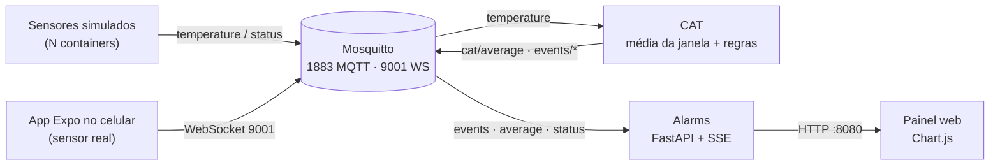

# Distributed Boiler Monitoring

**Monitoramento distribuído de caldeira com MQTT.**

Trabalho da disciplina de **Sistemas Distribuídos** do Mestrado em Ciência da Computação da **Universidade Federal do Ceará (UFC)**. Sensores de temperatura publicam leituras em um broker MQTT, um serviço **CAT** calcula a média móvel e detecta eventos, e um serviço **Alarms** exibe os alarmes em um painel web em tempo real.

> **Status:** Fases 1 a 5 concluídas (broker, sensores simulados, CAT, Alarms e o sensor real no app Expo). Falta a integração final (Fase 6). Veja [docs/fases.md](docs/fases.md).

## Visão geral



| Componente | Pasta | Tecnologia | Função |
|---|---|---|---|
| Broker | `mosquitto/` | Mosquitto 2.x | MQTT puro (TCP 1883) e WebSocket (9001) |
| Sensores simulados | `sensors-sim/` | Python 3.12 + paho-mqtt | Publicam temperatura; escaláveis com `--scale` |
| CAT | `cat-service/` | Python 3.12 + paho-mqtt | Média da janela e eventos de alarme |
| Alarms | `alarms-service/` | Python 3.12 + FastAPI + SSE + Chart.js | Painel web e saída no console |
| Sensor real | `mobile-app/` | React Native + Expo | Sensor real: luminosidade do celular convertida em temperatura, com slider de aquecimento |

## Pré-requisitos

- Docker Engine e Docker Compose v2.
- Opcional, para depurar no host: `sudo apt install mosquitto-clients` (também dá para usar os clientes dentro do container, veja abaixo).
- Python 3.12 no host, só para rodar os testes unitários.

## Como executar

```bash
docker compose up -d --build                # broker, CAT, Alarms e 1 sensor
docker compose up -d --scale sensors=3      # 3 sensores simulados
```

Painel: <http://localhost:8080>

Comandos úteis:

```bash
docker compose ps                           # estado dos containers
docker compose logs -f cat                  # médias e eventos do CAT
docker compose logs -f alarms               # alarmes no console
docker compose down                         # derruba tudo
```

Observar o tráfego MQTT (no host com `mosquitto-clients`, ou via container):

```bash
mosquitto_sub -h localhost -t "plant/#" -v
docker compose exec mosquitto mosquitto_sub -h localhost -t "plant/#" -v
```

## Configuração (`.env`)

Nenhum intervalo, janela ou limiar está fixo no código. Todos vêm de variáveis de ambiente.

| Variável | Valor de entrega | Valor atual (dev) | Descrição |
|---|---|---|---|
| `MQTT_HOST` / `MQTT_PORT` | `mosquitto` / `1883` | igual | Broker (dentro do Compose nunca é `localhost`) |
| `SENSOR_INTERVAL` | `60` | `5` | Segundos entre leituras de cada sensor |
| `CAT_WINDOW` | `120` | `10` | Janela da média, em segundos |
| `CAT_PERIOD` | `60` | `5` | Período entre cálculos da média |
| `CAT_JUMP_THRESHOLD` | `5` | `5` | Salto mínimo entre médias consecutivas (°C) |
| `CAT_HIGH_THRESHOLD` | `200` | `200` | Média acima da qual há temperatura alta (°C) |
| `ALARMS_MAX` / `ALARMS_HISTORY` | `50` / `200` | igual | Alarmes e pontos de gráfico mantidos em memória |
| `SENSOR_BASE` / `SENSOR_NOISE` | `80` / `1` (padrões do código) | `195` / `12` | Temperatura base e desvio do ruído; valores de dev para gerar mais alarmes |

> **Antes da entrega:** voltar `SENSOR_INTERVAL`, `CAT_WINDOW` e `CAT_PERIOD` para 60/120/60 e remover `SENSOR_BASE` e `SENSOR_NOISE` do `.env`.

## Tópicos MQTT

Prefixo: `plant/boiler1/`

| Tópico | Publicador | Descrição |
|---|---|---|
| `sensors/<sensor_id>/temperature` | Sensores / App | Leitura de temperatura (QoS 1) |
| `sensors/<sensor_id>/status` | Sensores / App | `online` (retain) ao conectar; `offline` (retain) via Last Will |
| `cat/average` | CAT | Média da janela, a cada `CAT_PERIOD` |
| `events/sudden_increase` | CAT | Médias consecutivas diferem em `CAT_JUMP_THRESHOLD` °C ou mais |
| `events/high_temperature` | CAT | Média acima de `CAT_HIGH_THRESHOLD` °C |

### Payloads (JSON)

Leitura:
```json
{"sensor_id": "sim-3f9a1c2b7d10", "value": 87.4, "unit": "C", "ts": 1760000000, "source": "simulated"}
```

Média (CAT):
```json
{"avg": 143.2, "prev_avg": 141.0, "sensors": 5, "window_s": 120, "ts": 1760000060}
```
`prev_avg` é `null` na primeira média.

Evento:
```json
{"type": "high_temperature", "avg": 213.5, "prev_avg": 198.0, "ts": 1760000060}
```

## App Expo (sensor real)

O app roda no host, fora do Docker, e usa o **Expo Go** (SDK 57). O celular precisa estar na mesma rede do notebook.

```bash
cd mobile-app
npm install
npx expo start        # escanear o QR code com o Expo Go
```

Na tela do app, informe o **IP do notebook** (`hostname -I`, nunca `localhost`), a porta `9001`, o ID do sensor e toque em **Conectar**. O app publica a cada 60 s (configurável) em `plant/boiler1/sensors/<id>/temperature` com `source: "phone-light"`, registra o Last Will em `/status` e publica `online` (retain) ao conectar. O **slider de aquecimento** soma até +60 °C à leitura para provocar os alarmes. Vários celulares podem conectar ao mesmo tempo, cada um com seu ID.

O `expo-sensors` não expõe temperatura. A leitura vem do sensor de luminosidade (só Android; no iOS vale a base mais o slider), convertido para a faixa de 180 a 200 °C.

## Testes

Testes unitários da lógica pura (sem MQTT, sem Docker):

```bash
(cd cat-service && python3 -m unittest discover -s tests -v)      # 17 testes
(cd alarms-service && python3 -m unittest discover -s tests -v)   # 10 testes
```

O roteiro dos testes de integração (pub/sub, Last Will, spike) está em [docs/testes.md](docs/testes.md).

## Documentação

- [docs/arquitetura.md](docs/arquitetura.md): componentes, fluxo de dados, concorrência e decisões de projeto.
- [docs/fases.md](docs/fases.md): o que foi entregue em cada fase e o que falta.
- [docs/testes.md](docs/testes.md): como verificar cada parte do sistema.
- [plano-projeto-mqtt.md](plano-projeto-mqtt.md): plano original do projeto.

## Estrutura do repositório

```
distributed-boiler-monitoring/
├── docker-compose.yml
├── .env
├── mosquitto/mosquitto.conf
├── sensors-sim/        # sensor.py, Dockerfile, requirements.txt
├── cat-service/        # window.py, rules.py, cat.py, tests/
├── alarms-service/     # state.py, mqtt_client.py, main.py, static/index.html, tests/
├── mobile-app/         # App.js, src/sensor.js (lógica pura), src/mqtt.js
├── docs/
└── plano-projeto-mqtt.md
```
