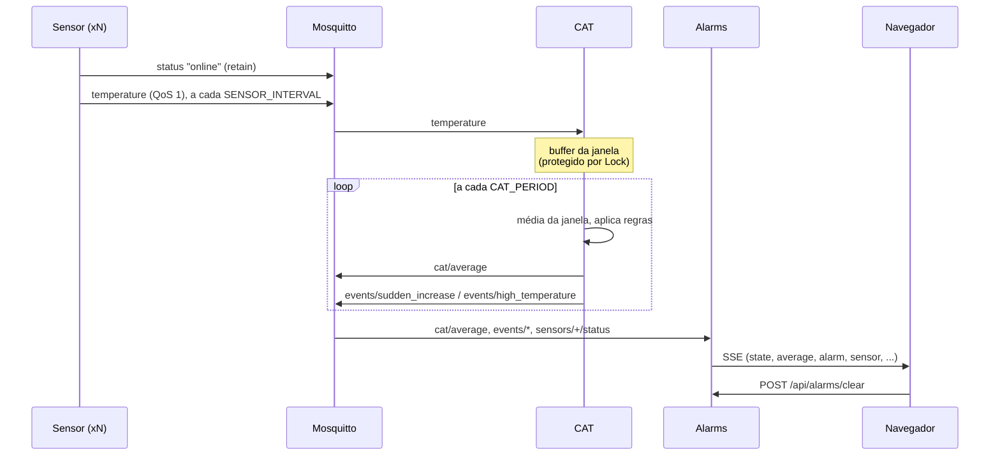

# Arquitetura

## Fluxo de dados

## Componentes

### Mosquitto (`mosquitto/mosquitto.conf`)
- Listener TCP 1883 (`protocol mqtt`) e WebSocket 9001 (`protocol websockets`, usado pelo app).
- `allow_anonymous true` e `persistence false`: adequado a um ambiente acadêmico local, sem autenticação.
- Healthcheck no Compose (`mosquitto_sub` em `$SYS/#`); os demais serviços usam `depends_on: service_healthy`.

### Sensores simulados (`sensors-sim/sensor.py`)
- Valor = `SENSOR_BASE` + deriva (`SENSOR_DRIFT`) + ruído gaussiano (`SENSOR_NOISE`).
- **Aquecimento forçado:** com `SPIKE=true`, soma `SPIKE_STEP` a cada leitura até `SPIKE_MAX`. É a forma de provocar os alarmes de forma controlada.
- **Identidade:** `sensor_id = sim-<hostname do container>`, também usado como `client_id`. Por isso o serviço não tem `container_name` nem porta publicada, o que permite `--scale`.
- **Last Will:** `offline` em `/status` com retain, registrado antes de conectar. Ao conectar, publica `online` com retain.
- **Encerramento limpo:** uma desconexão normal não aciona o Last Will, então no SIGTERM o sensor publica `offline` explicitamente.
- Reconexão automática (backoff de 1 a 10 s) e conexão assíncrona, para tolerar o broker ainda não estar de pé.

### CAT (`cat-service/`)
Separado em lógica pura e I/O:

| Arquivo | Papel |
|---|---|
| `window.py` | `ReadingBuffer` (janela deslizante com `threading.Lock`) e `compute_average` |
| `rules.py` | `AlarmRules`: decide quais eventos disparar |
| `cat.py` | I/O: assina o MQTT, roda o timer, publica média e eventos |

**Concorrência.** O callback do MQTT (thread do paho) chama `buffer.add()`, e o laço do timer (thread principal) chama `buffer.snapshot()`. O `Lock` protege a lista nas duas operações, e `snapshot()` devolve uma cópia.

**Regras.**
- `sudden_increase`: `|média_atual − média_anterior| ≥ CAT_JUMP_THRESHOLD`. Vale para subida e queda. Cada salto é um evento distinto. Não é avaliado na primeira média, que não tem anterior.
- `high_temperature`: `média > CAT_HIGH_THRESHOLD` (estrito). Dispara **só na transição** (de abaixo para acima do limiar) e rearma quando a média volta a ficar igual ou abaixo. Isso evita repetir o mesmo alarme a cada ciclo.

### Alarms (`alarms-service/`)

| Arquivo | Papel |
|---|---|
| `state.py` | `AlarmsState`: alarmes, histórico, sensores, interpretação das mensagens (sem rede) |
| `mqtt_client.py` | Conexão MQTT, assinaturas e saída no console |
| `main.py` | FastAPI: página, `/api/state`, `/api/stream` (SSE), `/api/alarms/clear` |
| `static/index.html` | Painel (HTML, CSS e JS puros, mais Chart.js) |

**Tempo real.** O navegador abre um `EventSource` em `/api/stream`. Ao conectar, recebe um evento `state` com o snapshot completo e depois eventos incrementais (`average`, `alarm`, `sensor`, `connection`, `clear`). O snapshot e o registro do listener são atômicos (mesmo `Lock`), então não se perde nem se duplica evento entre os dois. Se a conexão cair, o navegador reconecta sozinho e recebe um snapshot novo.

**Da thread MQTT para o event loop.** O listener roda na thread do paho e só chama `loop.call_soon_threadsafe`, que entrega o evento à `asyncio.Queue` de cada cliente SSE. Cada fila é limitada (200); se um cliente lento encher a fila, os eventos novos dele são descartados.

**Painel.** Status da conexão, média atual com variação, sensores na média, sensores online, lista de sensores, gráfico da média com a linha do limite, lista de alarmes (laranja: aumento repentino; vermelho: temperatura alta), banner com som opcional e botão de limpar.

**Segurança.** Os IDs de sensor vêm de qualquer cliente MQTT, então o painel os insere com `textContent`, nunca com `innerHTML`.

## Decisões de projeto

| Decisão | Motivo |
|---|---|
| Painel web em vez de `tkinter` | `tkinter` em container exige encaminhar o X11, o que é frágil; o painel funciona em container e abre em qualquer navegador |
| SSE em vez de WebSocket no painel | A comunicação é só do servidor para o navegador; SSE é mais simples e reconecta sozinho |
| Média das médias por sensor | Cada sensor pesa igual, mesmo que publique mais vezes na janela |
| Janela por hora de chegada, não pelo `ts` do payload | O relógio do celular pode estar defasado |
| Alarme de temperatura alta só na transição | Evita uma enxurrada de alarmes iguais enquanto a média fica alta |
| Configuração só por variáveis de ambiente | Permite reduzir tempos em desenvolvimento e voltar a 60/120 s na entrega sem tocar no código |
| Expo fora do Docker | O Metro bundler precisa ser alcançado pelo celular na rede local |
| App no SDK 57 | É a versão suportada pelo Expo Go instalado; o código só usa APIs estáveis |
| `sensor.js` separado do `mqtt.js` | Conversão e payload ficam puros, sem React nem MQTT |
| Chart.js via CDN | Evita empacotar a biblioteca; sem internet no navegador, só o gráfico deixa de funcionar |
| `state.py` separado do MQTT | Permite testar a lógica do painel sem broker (arquivo a mais em relação ao plano original) |

## Limitações conhecidas

- Broker sem autenticação e sem TLS.
- Sem persistência: reiniciar o Alarms apaga alarmes e histórico; reiniciar o broker apaga as mensagens retidas.
- Sensores simulados que somem e voltam com outro hostname deixam o ID antigo como `offline` na lista (o status é retido).
- O console do container Alarms mostra a hora em UTC (a imagem não tem fuso configurado); o painel usa a hora do navegador.
- O painel web não tem teste automatizado.
